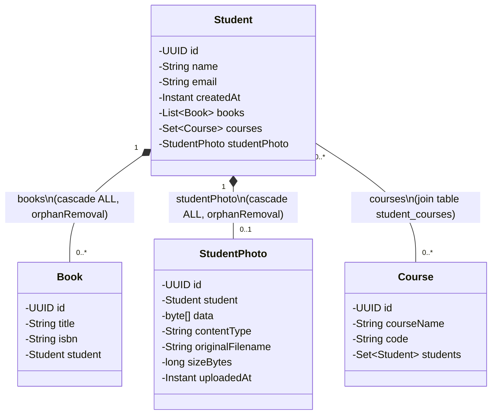

# Student Management

A Spring Boot REST API and web UI for managing students, their book loans, course enrollments, and ID photos.

## Features

- **Web UI** at `http://localhost:8080/`: students, books, courses, activity and undo. Plain HTML, CSS and JS in `src/main/resources/static`.
- **Student records**: create, read, update, delete, and search by name and/or status (paginated). Emails must be unique.
- **Student status**: ACTIVE, SUSPENDED, GRADUATED or WITHDRAWN. The status decides whether a student may edit their profile, borrow books or enroll (`POST /api/students/{id}/suspend|reactivate|graduate|withdraw`).
- **Book loans**: a book is lent to at most one student at a time, with a due date (`app.loans.period-days`) and a kept history (`GET /api/loans`, `GET /api/students/{id}/loans`).
- **Overdue handling**: an hourly check reports newly overdue loans and applies the configured overdue policy (see below).
- **CSV export**: `GET /api/export/students.csv`, `books.csv` and `loans.csv`.
- **Course enrollment**: enroll in and drop courses (many-to-many); no double enrollment.
- **Student photos**: upload, retrieve, and delete one ID photo per student (images only, max 2 MB).
- **Undo**: profile updates, lending, enrollment and status changes can be undone (`POST /api/commands/undo`).
- **Activity feed**: recent student events (`GET /api/activity`).

## Tech Stack

- Java 25, Spring Boot 4.1 (Web MVC, Data JPA, Validation, Scheduling)
- PostgreSQL, with the schema managed by Flyway
- springdoc-openapi (Swagger UI)
- JUnit 5 / Mockito, Testcontainers (tests run against Postgres 17 in Docker)
- Lombok

## Configuration

Set your database connection in `src/main/resources/application.properties`, or with the `DB_USERNAME` / `DB_PASSWORD` environment variables:

```properties
spring.datasource.url=jdbc:postgresql://localhost:5432/<your-db>
spring.datasource.username=<your-username>
spring.datasource.password=<your-password>
```

The schema is created and upgraded by Flyway migrations in `src/main/resources/db/migration`. Hibernate only validates it (`ddl-auto=validate`). Databases created before Flyway are baselined at version 1.

Optional settings (defaults shown):

```properties
app.security.api-key=my-secret-key
app.loans.period-days=14
app.loans.overdue-check-cron=0 0 * * * *
# What happens when a book is overdue: notify (report it) or suspend (also suspend the student)
app.loans.overdue-policy=notify
# With the suspend policy: how many days overdue before the student is suspended
app.loans.suspend-after-days=7
```

## Running the tests

`./mvnw test`. Docker must be running: database tests start a throwaway Postgres container with Testcontainers.

## Design patterns

| Pattern | Where |
|---|---|
| Observer | `StudentEventPublisher` and its listeners (activity log, logging) |
| Command (with undo) | `StudentCommand` implementations run by `StudentCommandInvoker` |
| Memento | `StudentMemento` snapshots a profile so an update can be undone |
| State | `StudentState` per `StudentStatus` decides what a student may do and which status changes are allowed |
| Strategy | `OverduePolicy`: `NotifyOnlyPolicy` or `SuspendStudentPolicy`, chosen by `app.loans.overdue-policy` |
| Template Method | `CsvExporter.export()` fixes the CSV steps; `StudentCsvExporter`, `BookCsvExporter` and `LoanCsvExporter` fill them in |

## Authentication

All `/api/**` requests must include an `X-Api-Key` header. See `SimpleApiKeyFilter` for the configured key.

## Architecture

Full diagrams with field-level detail and method signatures are in [docs/uml.md](docs/uml.md); the domain model is reproduced here.



## Known Limitations

- Access control is a single shared API key — there are no user identities, roles, or per-resource authorization.
- Deleting a student also deletes the books they currently have borrowed (cascade on `Student.books`).
- Undo history and the activity feed are kept in memory and are lost on restart.
