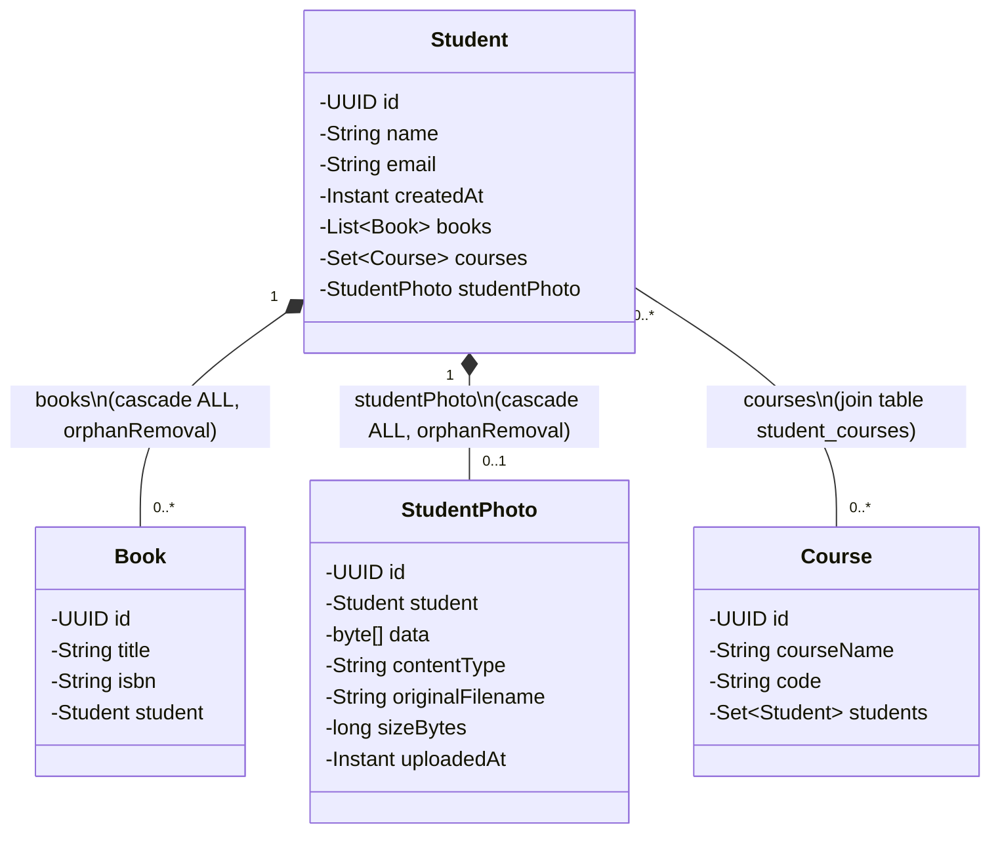

# Student Management

A Spring Boot REST API and web UI for managing students, their book loans, course enrollments, and ID photos.

## Features

- **Web UI** at `http://localhost:8080/`: students, books, courses, activity and undo. Plain HTML, CSS and JS in `src/main/resources/static`.
- **Student records**: create, read, update and delete (paginated). Emails must be unique.
- **Student search**: `GET /api/students` filters by any combination of `name`, `email` (contains, ignoring case), `status` (repeat it for "any of"), `course` (enrolled in), `overdue=true` (has a late book) and `createdFrom`/`createdTo` (inclusive dates, UTC).
- **Student status**: ACTIVE, SUSPENDED, GRADUATED or WITHDRAWN. The status decides whether a student may edit their profile, borrow books or enroll (`POST /api/students/{id}/suspend|reactivate|graduate|withdraw`).
- **Book loans**: a book is lent to at most one student at a time, with a due date (`app.loans.period-days`) and a kept history (`GET /api/loans`, `GET /api/students/{id}/loans`).
- **Overdue handling**: an hourly check reports newly overdue loans and applies the configured overdue policy (see below).
- **Export (CSV or JSON)**: `GET /api/export/{students|books|loans}.{csv|json}`, and the reports as files: `GET /api/reports/statistics.{csv|json}` and `/api/reports/audit.{csv|json}`.
- **Book copies**: add more copies of a book with the same title and ISBN (`POST /api/books/{id}/copies?count=3`, at most 20 at a time).
- **Course enrollment**: enroll in and drop courses (many-to-many); no double enrollment.
- **Student photos**: upload, retrieve, and delete one ID photo per student (images only, max 2 MB), kept in the database or in a folder (`app.photos.storage`).
- **Undo**: profile updates, lending, enrollment and status changes can be undone (`POST /api/commands/undo`).
- **Repeat for other students**: an enrollment, course drop or status change in the undo history can be repeated for a list of students (`GET /api/commands/entries`, `POST /api/commands/{id}/repeat` with `{"studentIds": [...]}`). Each student gets their own result and their own undo entry.
- **Activity feed**: recent student events (`GET /api/activity`).
- **Notifications**: students get a message when they join, a book is overdue, they are enrolled in or dropped from a course, or their status changes. Kept in an in-app inbox (`GET /api/students/{id}/notifications`, `GET .../unread-count`, `POST .../read` to mark all read) or written to the log (`app.notifications.channel`).

## Tech Stack

- Java 25, Spring Boot 4.1 (Web MVC, Data JPA, Validation, Scheduling)
- PostgreSQL, with the schema managed by Flyway
- springdoc-openapi (Swagger UI)
- JUnit 5 / Mockito, Testcontainers (tests run against Postgres 17 in Docker)
- Lombok

## Configuration

Set your database connection in `src/main/resources/application.properties`, or with the `DB_USERNAME` / `DB_PASSWORD` environment variables:

```properties
spring.datasource.url=jdbc:postgresql://localhost:5432/<your-db>
spring.datasource.username=<your-username>
spring.datasource.password=<your-password>
```

The schema is created and upgraded by Flyway migrations in `src/main/resources/db/migration`. Hibernate only validates it (`ddl-auto=validate`). Databases created before Flyway are baselined at version 1.

Optional settings (defaults shown):

```properties
app.security.api-key=my-secret-key
app.loans.period-days=14
app.loans.overdue-check-cron=0 0 * * * *
# What happens when a book is overdue: notify (report it) or suspend (also suspend the student)
app.loans.overdue-policy=notify
# With the suspend policy: how many days overdue before the student is suspended
app.loans.suspend-after-days=7
# Where student photos are kept: database, or filesystem (in app.photos.directory)
app.photos.storage=database
app.photos.directory=${user.home}/.student-management/photos
# How notifications reach students: inbox (kept in the database) or log
app.notifications.channel=inbox
```

Photos kept in a folder are not part of database transactions or backups, and the statistics and audit reports only see photos stored in the database.

## Running the tests

`./mvnw test`. Docker must be running: database tests start a throwaway Postgres container with Testcontainers.

## Design patterns

| Pattern | Where |
|---|---|
| Observer | `StudentEventPublisher` and its listeners (activity log, logging, notifications, Spring bridge) |
| Command (with undo) | `StudentCommand` implementations run by `StudentCommandInvoker` |
| Memento | `StudentMemento` snapshots a profile so an update can be undone |
| State | `StudentState` per `StudentStatus` decides what a student may do and which status changes are allowed |
| Strategy | `OverduePolicy`: `NotifyOnlyPolicy` or `SuspendStudentPolicy`, chosen by `app.loans.overdue-policy` |
| Template Method | `TableExporter.export()` fixes the export steps; `StudentExporter`, `BookExporter` and `LoanExporter` fill them in |
| Abstract Factory | `ExportFormatFactory` creates a matching family of writers (`TableWriter`, `ReportWriter`) plus media type and extension per format: `CsvFormatFactory` or `JsonFormatFactory`, picked from the URL's extension |
| Prototype | `StudentCommand.copyFor(studentId)` copies a history entry for another student without knowing its concrete class (`CommandRepeater`); `Book.copy()` makes another copy of a book |
| Builder | `StudentSearch.builder()` assembles optional search criteria into one JPA `Specification`; `BookLoan.lend(book).to(student).borrowedAt(..).dueAfter(..)` is a step builder that will not compile without every required part |
| Adapter | `FileSystemPhotoStorage` adapts `java.nio.file.Files` to `PhotoStorage`, as an alternative to the database (`app.photos.storage=filesystem`); `SpringEventBridge` forwards every `StudentEvent` to Spring so beans can use `@EventListener` / `@TransactionalEventListener`, and `StudentEventApplicationListener` wraps a `StudentEventListener` as a Spring `ApplicationListener` |
| Bridge | Notifications: the kind of message (`StudentNotification`: `WelcomeNotification`, `OverdueReminder`, `EnrollmentNotice`, `StatusChangeNotice`) holds the way it is delivered (`NotificationChannel`: `InboxNotificationChannel` or `LogNotificationChannel`, chosen by `app.notifications.channel`), so both sides grow independently. Exports are bridged the same way: every `TableExporter` writes through whichever `TableWriter` the chosen format creates |

## Authentication

All `/api/**` requests must include an `X-Api-Key` header. See `SimpleApiKeyFilter` for the configured key.

## Architecture

Full diagrams with field-level detail and method signatures are in [docs/uml.md](docs/uml.md); the domain model is reproduced here.



## Known Limitations

- Access control is a single shared API key — there are no user identities, roles, or per-resource authorization.
- Deleting a student also deletes the books they currently have borrowed (cascade on `Student.books`).
- Undo history and the activity feed are kept in memory and are lost on restart.
